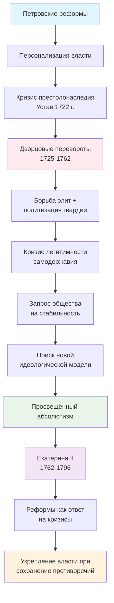

# Просвещённый абсолютизм Екатерины II

## От дворцовых переворотов к стабильности

-   :material-history: __Эпоха дворцовых переворотов__

    ---

    Анализ системного кризиса власти после смерти Петра I. Изучение причин политической нестабильности 1725-1762 гг.

    [:octicons-arrow-right-24: Перейти к разделу](coups/index.md)

-   :material-lightbulb: __Просвещённый абсолютизм__

    ---

    Теория и практика модели власти, сочетающей идеи Просвещения с абсолютной монархией.

    [:octicons-arrow-right-24: Изучить теорию](enlightenment/index.md)

-   :material-crown: __Политика Екатерины II__

    ---

    Реформы, идеология и противоречия правления императрицы. Анализ связи с предшествующей эпохой.

    [:octicons-arrow-right-24: Изучить реформы](catherine/index.md)

-   :material-chart-line: __Аналитика и выводы__

    ---

    Причинно-следственные связи, системный анализ, исторические закономерности.

    [:octicons-arrow-right-24: Смотреть анализ](analysis/index.md)

<!-- Улучшенные кликабельные блоки для быстрой навигации -->

<a href="coups/index.md" class="home-card" data-tooltip="Изучить эпоху дворцовых переворотов">
    
👑

    
Эпоха дворцовых переворотов

    

        Анализ системного кризиса власти после смерти Петра I. Изучение причин политической нестабильности 1725-1762 гг.
    

</a>

<a href="enlightenment/index.md" class="home-card" data-tooltip="Изучить теорию просвещённого абсолютизма">
    
💡

    
Просвещённый абсолютизм

    

        Теория и практика модели власти, сочетающей идеи Просвещения с абсолютной монархией.
    

</a>

<a href="catherine/index.md" class="home-card" data-tooltip="Изучить политику Екатерины II">
    
👸

    
Политика Екатерины II

    

        Реформы, идеология и противоречия правления императрицы. Анализ связи с предшествующей эпохой.
    

</a>

<a href="analysis/index.md" class="home-card" data-tooltip="Смотреть аналитику и выводы">
    
📊

    
Аналитика и выводы

    

        Причинно-следственные связи, системный анализ, исторические закономерности.
    

</a>

## :material-star: Ключевые темы исследования

=== "Системный кризис власти"
    !!! success "Анализ эпохи дворцовых переворотов"
        Исследование показывает, что кризис 1725-1762 гг. носил **системный характер**:
        
        - Кризис престолонаследия после Устава 1722 г.
        - Политизация гвардии как инструмента смены власти
        - Размывание институциональной системы управления
        - Бюрократизация и рост коррупции
        
        [:octicons-arrow-right-24: Подробный анализ](coups/problems.md)

=== "Просвещённый абсолютизм"
    !!! info "Теория и практика"
        Политика Екатерины II представляла собой **компромиссную модель**:
        
        - Использование идей Просвещения для легитимации власти
        - Сохранение самодержавия при частичной модернизации
        - Адаптация европейских концепций к российским условиям
        - Внутренние противоречия и ограничения
        
        [:octicons-arrow-right-24: Изучить теорию](enlightenment/index.md)

=== "Реформы Екатерины II"
    !!! tip "Системные преобразования"
        Реформы императрицы были **ответом на вызовы** предшествующей эпохи:
        
        - Губернская реформа (1775) - создание устойчивой системы управления
        - Жалованные грамоты (1785) - закрепление прав сословий
        - Уложенная комиссия (1767) - попытка правовой модернизации
        - Образовательная и культурная политика
        
        [:octicons-arrow-right-24: Смотреть реформы](catherine/reforms.md)

## :material-timeline: Причинно-следственная схема

[:material-download: Скачать схему в PDF](#){ .md-button .md-button--primary }

## :material-interaction: Интерактивные материалы

-   :material-calendar-clock: __Хронология эпохи__

    ---

    Детальная временная шкала событий 1725-1796 гг. с анализом значения каждого события.

    [:octicons-arrow-right-24: Открыть хронологию](interactive/timeline.md)

-   :material-book: __Таблица источников__

    ---

    Систематизация 7 ключевых источников исследования с методологическим анализом.

    [:octicons-arrow-right-24: Смотреть источники](interactive/sources_table.md)

-   :material-clipboard-list: __Таблица реформ__

    ---

    Анализ 8 основных реформ Екатерины II с установлением связей к эпохе переворотов.

    [:octicons-arrow-right-24: Изучить реформы](interactive/reforms_table.md)

-   :material-sitemap: __Причинно-следственные схемы__

    ---

    Визуализация системных связей между историческими явлениями и процессами.

    [:octicons-arrow-right-24: Смотреть схемы](interactive/causal_schemes.md)

## :material-compass: Навигация по исследованию

### Этап 1: Сбор и первичный анализ (10.03)

1.  **Изучение эпохи дворцовых переворотов** как исторического фона
2.  **Анализ политики просвещённого абсолютизма** в общем и частном контексте
3.  **Определение предпосылок** формирования политики Екатерины II
4.  **Создание чернового варианта** сайта с отобранной информацией

    [:octicons-arrow-right-24: Результаты этапа 1](introduction.md#этап-1-1003---сбор-и-первичный-анализ-материала){ .md-button .md-button--secondary }

### Этап 2: Углублённый анализ (01.04)

1.  **Анализ практической реализации** идей просвещённого абсолютизма
2.  **Установление связи** между реформами Екатерины II и эпохой дворцовых переворотов
3.  **Изучение внутренней и внешней политики** императрицы
4.  **Доработка и структурирование** материалов для сайта

    [:octicons-arrow-right-24: Результаты этапа 2](introduction.md#этап-2-0104---углублённый-анализ-политики-екатерины-ii){ .md-button .md-button--secondary }

## :material-eye: Визуальная галерея

!!! note "Портреты императоров эпохи"
    Согласно исследованию Никитченко А.К., портреты императоров служат важным историческим источником, отражающим политические изменения и инструменты легитимации власти.

    

    -   __Екатерина I__ (1725-1727)
    
        ---
    
        Образ монарха, заботящегося о подданных. Роскошные наряды подчеркивают статус императрицы.
    
        [:octicons-image-24: Смотреть портрет](coups/index.md#галерея-портретов-императоров-эпохи)
    
    -   __Анна Иоанновна__ (1730-1740)
    
        ---
    
        Первый визуальный образ стабилизации после череды переворотов. Властный взгляд укрепляет авторитет.
    
        [:octicons-image-24: Смотреть портрет](coups/index.md#галерея-портретов-императоров-эпохи)
    
    -   __Пётр III__ (1761-1762)
    
        ---
    
        Образ слабого монарха. Слабость визуального образа → слабость легитимности → новый переворот.
    
        [:octicons-image-24: Смотреть портрет](coups/index.md#галерея-портретов-императоров-эпохи)
    
    -   __Екатерина II__ (1762-1796)
    
        ---
    
        Образ "просвещённой монархини". Корона и скипетр символизируют абсолютную власть.
    
        [:octicons-image-24: Смотреть портрет](coups/index.md#галерея-портретов-императоров-эпохи)
    
    

    [:octicons-gallery-24: Открыть полную галерею](coups/index.md#галерея-портретов-императоров-эпохи){ .md-button }

## :material-help: Быстрый старт

-   __Новичкам__

    ---

    Начните с **[Введения](introduction.md)**, чтобы понять цели и задачи исследования, затем перейдите к **[Эпохе дворцовых переворотов](coups/index.md)**.

    [:octicons-rocket-24: Начать изучение](introduction.md){ .md-button .md-button--primary }

-   __Исследователям__

    ---

    Изучите **[Аналитику](analysis/index.md)** для понимания системных связей, затем углубитесь в **[Интерактивные материалы](interactive/timeline.md)**.

    [:octicons-search-24: К аналитике](analysis/index.md){ .md-button }

-   __Преподавателям__

    ---

    Используйте **[Таблицы реформ](interactive/reforms_table.md)** и **[Хронологию](interactive/timeline.md)** как готовые учебные материалы.

    [:octicons-book-24: К материалам](interactive/timeline.md){ .md-button }

## :material-information: О проекте

!!! abstract "Методологическая основа"
    Исследование построено на **комплексном анализе** исторических источников с использованием:
    
    - **Историко-генетического метода** для выявления причинно-следственных связей
    - **Сравнительно-исторического метода** для анализа европейского и российского опыта
    - **Системного подхода** для изучения политической системы как целостности
    - **Контент-анализа** для работы с текстовыми источниками

!!! success "Научная новизна"
    Проект представляет **инновационный подход** к изучению политики Екатерины II через призму связи с эпохой дворцовых переворотов, сочетая традиционные исторические методы с современными технологиями презентации.

[:octicons-info-24: Подробнее о методологии](introduction.md#методологическая-основа){ .md-button }

---

*Проект завершён в соответствии с планами этапов 1 и 2. Все материалы структурированы и представлены на интерактивном образовательном ресурсе.*

**Сайт проекта:** [https://absolutism.sourcecraft.site/pr-absolutism/](https://absolutism.sourcecraft.site/pr-absolutism/)

